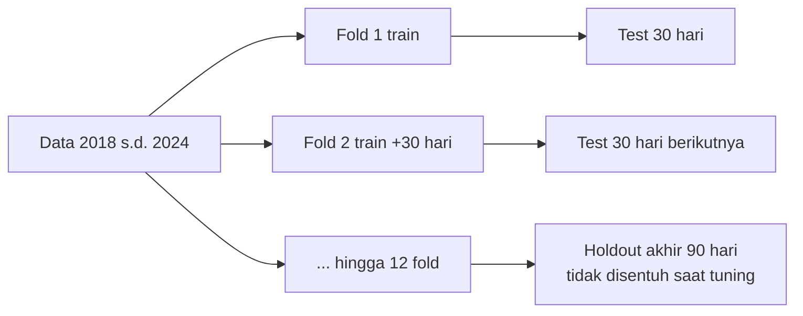
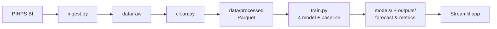

# 

# PRD —Prediksi Harga Pangan Harian (PIHPS)

Sep 24, 2026 · @Aditama

## Ringkasan Produk

Proyek ini membangun sistem forecasting harga harian cabai, bawang, dan beras dari data PIHPS Bank Indonesia, dengan horizon prediksi 7, 14, dan 30 hari. Empat model (ARIMA/SARIMA, Prophet, XGBoost, LSTM) dibandingkan secara adil dengan protokol validasi yang sama. Hasilnya disajikan dalam dashboard Streamlit yang bisa dipakai tanpa menulis kode.

Nama kerja: **PanganCast**. Target rilis v1.0: 3 minggu sejak kickoff.

## Latar Belakang dan Masalah

Harga cabai dan bawang di Indonesia sangat volatil karena dipengaruhi musim tanam, cuaca, dan momen hari besar seperti Ramadan, Lebaran, Natal, dan Tahun Baru. Beras lebih stabil, tetapi kenaikannya berdampak besar pada inflasi dan daya beli.

Masalah yang ingin dijawab:

- Data PIHPS tersedia publik, tetapi hanya menampilkan harga historis, belum ada proyeksi ke depan.
- Pedagang, UMKM kuliner, dan konsumen sulit merencanakan pembelian stok tanpa gambaran tren.
- Belum banyak studi terbuka yang membandingkan model statistik klasik, machine learning, dan deep learning pada data harga pangan Indonesia secara apple-to-apple.

## Tujuan, Non-tujuan, dan Metrik Keberhasilan

**Tujuan**

1. Membangun pipeline data PIHPS yang reproducible: unduh, bersihkan, simpan.
2. Melatih dan membandingkan 4 model dengan protokol validasi yang identik.
3. Menentukan model terbaik per komoditas berdasarkan metrik kuantitatif.
4. Men-deploy dashboard Streamlit publik yang menampilkan historis, forecast, dan perbandingan model.

**Non-tujuan (di luar scope v1.0)**

- Prediksi per pasar atau per kabupaten; v1.0 cukup level nasional plus 1 provinsi (DI Yogyakarta).
- Update data otomatis real-time; v1.0 memakai refresh manual atau terjadwal mingguan.
- Memasukkan variabel eksternal kompleks seperti curah hujan dan kurs; ini masuk pengembangan lanjutan.
- Aplikasi mobile atau sistem login pengguna.

**Metrik keberhasilan**

| Metrik | Target |
| --- | --- |
| MAPE model terbaik, horizon 7 hari, beras | < 3% |
| MAPE model terbaik, horizon 7 hari, cabai dan bawang | < 12% |
| Model terbaik mengalahkan baseline naive (harga kemarin) | Ya, di semua komoditas |
| Waktu muat dashboard | < 3 detik |
| Reproducibility | `make train` menghasilkan metrik yang sama (seed tetap) |

Target MAPE di atas adalah asumsi awal dan akan dikalibrasi setelah baseline dihitung.

## Persona dan User Stories

| Persona | Kebutuhan utama |
| --- | --- |
| Pemilik UMKM kuliner (warung, rumah makan) | Tahu kapan harga cabai dan bawang akan naik untuk menyetok lebih awal |
| Analis data atau mahasiswa | Membandingkan performa model dan mengunduh hasil forecast |
| Recruiter atau penilai portofolio | Memahami proyek dalam 2 menit lewat dashboard dan README |

**User stories**

- [ ] Sebagai pemilik UMKM, saya ingin memilih komoditas dan melihat prediksi 7 hari ke depan, agar bisa merencanakan belanja.
- [ ] Sebagai pemilik UMKM, saya ingin melihat rentang ketidakpastian (batas bawah–atas), agar tahu seberapa yakin prediksinya.
- [ ] Sebagai analis, saya ingin melihat tabel MAE, RMSE, dan MAPE semua model per komoditas, agar bisa memilih model terbaik.
- [ ] Sebagai analis, saya ingin mengunduh hasil forecast dalam CSV.
- [ ] Sebagai analis, saya ingin melihat pola musiman (mingguan, tahunan, efek Lebaran) dari data historis.
- [ ] Sebagai recruiter, saya ingin halaman "Tentang Proyek" yang menjelaskan metodologi secara ringkas.

## Ruang Lingkup Data

Sumber utama adalah PIHPS Nasional Bank Indonesia (bi.go.id/hargapangan), jenis pasar tradisional, periode Januari 2018 sampai data terbaru. v1.0 memakai 5 komoditas × 2 wilayah = 10 deret waktu.

| Komoditas (varian PIHPS) | Satuan | Karakter harga |
| --- | --- | --- |
| Beras Kualitas Medium I | Rp/kg | Stabil, tren naik perlahan |
| Bawang Merah Ukuran Sedang | Rp/kg | Volatil, musiman |
| Bawang Putih Ukuran Sedang | Rp/kg | Dipengaruhi impor |
| Cabai Merah Keriting | Rp/kg | Sangat volatil |
| Cabai Rawit Merah | Rp/kg | Sangat volatil, lonjakan ekstrem |

Wilayah: **Nasional** (rata-rata) dan **DI Yogyakarta**. Nama varian perlu dicocokkan ulang dengan label di situs PIHPS saat eksplorasi data.

**Skema data bersih (tabel `prices`)**

| Kolom | Tipe | Keterangan |
| --- | --- | --- |
| date | date | Tanggal observasi |
| region | string | `nasional` atau `diy` |
| commodity | string | Slug komoditas, mis. `cabai_rawit_merah` |
| price | float | Harga Rp/kg |
| is\_imputed | bool | True jika nilai hasil imputasi |

**Aturan pembersihan**

- Hari libur dan akhir pekan yang kosong diisi dengan forward-fill, maksimal 3 hari berturut-turut; celah lebih panjang memakai interpolasi linear dan ditandai `is_imputed`.
- Outlier dicek dengan rolling z-score (window 30 hari); lonjakan nyata saat hari raya tidak dihapus, hanya kesalahan input yang jelas.
- Data mentah disimpan apa adanya di `data/raw/`, hasil bersih di `data/processed/` dalam format Parquet.

**Fitur tambahan (kalender)**: hari dalam minggu, bulan, penanda H-14 sampai H+7 Idulfitri, Iduladha, Natal, dan Tahun Baru. Tanggal hari raya diambil dari library `holidays` (ID) atau tabel manual.

## Kebutuhan Fungsional

| ID | Modul | Kebutuhan | Prioritas |
| --- | --- | --- | --- |
| F-01 | Data | Script unduh data PIHPS per komoditas dan wilayah (scraping atau unduhan Excel) | Wajib |
| F-02 | Data | Pembersihan, imputasi, dan validasi skema sesuai aturan di atas | Wajib |
| F-03 | EDA | Notebook EDA: tren, dekomposisi musiman (STL), ACF/PACF, efek hari raya | Wajib |
| F-04 | Model | Training 4 model + baseline naive untuk 10 deret waktu | Wajib |
| F-05 | Model | Hyperparameter tuning per model (Optuna atau grid search) | Wajib |
| F-06 | Evaluasi | Rolling-origin backtest dan tabel metrik per model × komoditas × horizon | Wajib |
| F-07 | Evaluasi | Uji signifikansi Diebold-Mariano antara model terbaik dan runner-up | Opsional |
| F-08 | Artefak | Simpan model terlatih dan hasil forecast ke `models/` dan `outputs/` | Wajib |
| F-09 | Dashboard | Pilih komoditas, wilayah, model, dan horizon; tampilkan grafik interaktif | Wajib |
| F-10 | Dashboard | Prediction interval (80% dan 95%) pada grafik forecast | Wajib |
| F-11 | Dashboard | Leaderboard model dan grafik error per horizon | Wajib |
| F-12 | Dashboard | Unduh forecast sebagai CSV | Wajib |
| F-13 | Dashboard | Peringatan kenaikan: tandai jika prediksi naik > 10% dalam 7 hari | Opsional |
| F-14 | Ops | GitHub Actions: lint, test, dan retrain mingguan terjadwal | Opsional |

## Metodologi Pemodelan

Semua model dilatih pada log harga, lalu hasil prediksinya dikembalikan ke skala Rupiah. Transformasi log menstabilkan varians pada komoditas yang lonjakannya ekstrem seperti cabai rawit.

| Model | Pendekatan | Konfigurasi utama | Strategi multi-step |
| --- | --- | --- | --- |
| Baseline naive | Harga besok = harga hari ini; juga seasonal naive (lag 7) | Tanpa parameter | Langsung |
| ARIMA / SARIMA | Statistik klasik | `pmdarima.auto_arima`, uji ADF untuk differencing, musiman mingguan (m=7) | Rekursif bawaan |
| Prophet | Dekomposisi aditif | Musiman mingguan dan tahunan, regresor hari raya, tuning `changepoint_prior_scale` | Langsung |
| XGBoost | Gradient boosting pada fitur tabular | Lag 1–30, rolling mean/std 7/14/30, fitur kalender dan hari raya | Direct: satu model per horizon (7, 14, 30) |
| LSTM | Deep learning sekuensial | Window 60 hari, 1–2 layer (32–128 unit), dropout, early stopping, scaling Min-Max hanya dari data train | Output vektor (multi-output) |

**Aturan anti data leakage**

- Scaler, imputasi, dan fitur rolling hanya di-fit pada data train di setiap fold.
- Fitur lag untuk XGBoost dibuat dengan `shift` yang benar, tanpa melihat masa depan.
- Tidak ada shuffle pada data deret waktu.

**Validasi: rolling-origin (expanding window)**



Tuning hyperparameter hanya memakai fold backtest. Holdout 90 hari terakhir dipakai sekali di akhir untuk laporan performa final.

## Metrik Evaluasi dan Protokol Perbandingan

Metrik utama untuk memilih model adalah MASE, karena skalanya netral dan langsung membandingkan model dengan baseline naive (MASE < 1 berarti lebih baik dari naive).

| Metrik | Kegunaan |
| --- | --- |
| MAE (Rp/kg) | Error rata-rata yang mudah dipahami pengguna awam |
| RMSE (Rp/kg) | Menghukum error besar, penting saat lonjakan harga |
| MAPE (%) | Perbandingan lintas komoditas dengan harga berbeda |
| MASE | Metrik utama pemilihan model |
| Coverage interval 80%/95% | Mengecek apakah prediction interval terkalibrasi |
| Directional accuracy (%) | Seberapa sering arah naik/turun tertebak benar |

Rumus MASE:

```latex
\text{MASE} = \frac{\frac{1}{h}\sum_{t=1}^{h} |y_t - \hat{y}_t|}{\frac{1}{n-1}\sum_{t=2}^{n} |y_t - y_{t-1}|}
```

**Protokol perbandingan**

1. Semua model memakai fold, horizon, dan data yang sama persis.
2. Metrik dihitung per komoditas × wilayah × horizon, lalu dirata-rata antar fold.
3. Pemenang per komoditas = MASE terendah pada horizon 7 hari; hasil horizon 14 dan 30 dilaporkan terpisah.
4. Waktu training dan inferensi setiap model ikut dicatat sebagai pertimbangan praktis.
5. Semua hasil disimpan di `outputs/metrics.csv` sebagai sumber tunggal untuk dashboard dan README.

## Arsitektur dan Tech Stack

Training berjalan offline; dashboard hanya membaca artefak yang sudah jadi, sehingga cepat dan ringan di Streamlit Community Cloud.



| Lapisan | Pilihan |
| --- | --- |
| Bahasa | Python 3.11 |
| Data | pandas, pyarrow, requests / BeautifulSoup |
| Statistik | statsmodels, pmdarima |
| Prophet | prophet |
| ML | xgboost, scikit-learn, optuna |
| Deep learning | TensorFlow/Keras atau PyTorch (pilih satu) |
| Visualisasi | plotly |
| Dashboard | Streamlit, deploy ke Streamlit Community Cloud |
| Eksperimen | MLflow lokal (opsional) atau log CSV |
| Kualitas kode | ruff, pytest, pre-commit, GitHub Actions |

**Struktur repo**

```
pangancast/
├── data/            # raw/ dan processed/ (raw di .gitignore jika besar)
├── notebooks/       # 01_eda.ipynb, 02_model_experiments.ipynb
├── src/
│   ├── ingest.py
│   ├── clean.py
│   ├── features.py
│   ├── models/      # arima.py, prophet_model.py, xgb.py, lstm.py, naive.py
│   ├── backtest.py
│   └── evaluate.py
├── models/          # model terlatih
├── outputs/         # forecast.parquet, metrics.csv
├── app/             # streamlit_app.py + pages/
├── tests/
├── configs/config.yaml
├── Makefile
├── requirements.txt
└── README.md
```

## Desain Dashboard Streamlit

Dashboard terdiri dari 4 halaman dengan sidebar filter yang sama: komoditas, wilayah, model, dan horizon.

| Halaman | Komponen |
| --- | --- |
| 1. Forecast | Kartu KPI (harga terakhir, prediksi H+7, perubahan %), grafik historis 180 hari + forecast + interval 80/95%, badge peringatan kenaikan, tombol unduh CSV |
| 2. Perbandingan Model | Leaderboard (MAE, RMSE, MAPE, MASE) dengan pemenang di-highlight, grafik error per horizon, overlay prediksi semua model pada holdout |
| 3. Eksplorasi Data | Tren multi-komoditas, dekomposisi STL, heatmap harga rata-rata per bulan × tahun, zoom periode Lebaran |
| 4. Tentang Proyek | Ringkasan metodologi, sumber data dan tanggal update, keterbatasan, link GitHub |

**Aturan UX**

- Default saat dibuka: Cabai Rawit Merah, Nasional, model terbaik, horizon 7 hari.
- Semua angka Rupiah diformat `Rp 45.250/kg`.
- Data dan model dimuat dengan `st.cache_data` dan `st.cache_resource`.
- Disclaimer singkat: prediksi bersifat indikatif, bukan saran transaksi.

## Kebutuhan Non-fungsional

| Aspek | Kebutuhan |
| --- | --- |
| Performa | Dashboard termuat < 3 detik; ganti filter < 1 detik |
| Reproducibility | Seed tetap, versi library dikunci di `requirements.txt`, semua parameter di `configs/config.yaml` |
| Kualitas kode | Coverage test ≥ 60% untuk `src/`, lulus ruff, docstring di fungsi publik |
| Ukuran deploy | Total artefak model < 200 MB agar muat di Streamlit Community Cloud |
| Dokumentasi | README berisi arsitektur, cara menjalankan, tabel hasil, screenshot, dan link demo |
| Etika data | Menyebut sumber PIHPS BI, tidak membebani server (jeda antar request, cache lokal) |
| Lisensi | MIT |

## Milestone dan Timeline

Total 21 hari kerja, dihitung dari hari kickoff (H1).

| Hari | Milestone | Output |
| --- | --- | --- |
| H1–H3 | Setup dan data | Repo, struktur folder, `ingest.py`, data mentah 10 deret waktu |
| H4–H5 | Cleaning dan EDA | `clean.py`, notebook EDA, temuan musiman dan efek hari raya |
| H6 | Baseline dan backtest | `backtest.py`, metrik baseline naive sebagai patokan |
| H7–H8 | ARIMA/SARIMA | Model + tuning + metrik |
| H9–H10 | Prophet | Model + regresor hari raya + metrik |
| H11–H12 | XGBoost | Feature engineering + model direct per horizon + metrik |
| H13–H15 | LSTM | Model + tuning + metrik |
| H16 | Evaluasi final | Leaderboard, holdout test, `metrics.csv` |
| H17–H19 | Dashboard | 4 halaman Streamlit, deploy ke Community Cloud |
| H20 | Testing dan CI | pytest, GitHub Actions |
| H21 | Dokumentasi | README lengkap, screenshot, posting portofolio |

## Risiko dan Mitigasi

| Risiko | Dampak | Mitigasi |
| --- | --- | --- |
| Situs PIHPS berubah atau memblokir scraping | Pipeline data gagal | Simpan snapshot data mentah di repo atau release; sediakan jalur unduhan manual Excel |
| Banyak data kosong di level provinsi | Model DIY kurang akurat | Batasi imputasi; jika celah > 10%, ganti DIY dengan provinsi lain yang lebih lengkap |
| Lonjakan ekstrem cabai (shock cuaca) | Error besar di semua model | Transformasi log, laporkan error per periode normal vs lonjakan, tampilkan interval ketidakpastian |
| LSTM overfit karena data harian relatif sedikit (± 3.000 titik) | Performa LSTM buruk | Early stopping, dropout, model kecil; hasil buruk tetap dilaporkan jujur sebagai temuan |
| Artefak model terlalu besar untuk deploy | Dashboard gagal jalan | Simpan hanya model pemenang di deploy; simpan forecast sebagai tabel, bukan re-inference |
| Waktu tuning lama | Timeline molor | Batasi trial Optuna (mis. 30 trial), tuning hanya pada 2 komoditas representatif lalu terapkan ke yang lain |

## Definition of Done dan Pengembangan Lanjutan

Proyek dianggap selesai (v1.0) jika semua poin berikut terpenuhi:

- [ ] 10 deret waktu bersih tersedia dan pipeline bisa dijalankan ulang dengan `make data`
- [ ] 4 model + baseline dievaluasi dengan rolling-origin backtest yang sama
- [ ] `metrics.csv` dan leaderboard menunjukkan model terbaik per komoditas
- [ ] Dashboard 4 halaman live di Streamlit Community Cloud
- [ ] Test dan CI lulus di GitHub Actions
- [ ] README lengkap dengan arsitektur, hasil, screenshot, dan link demo

**Pengembangan lanjutan (v2.0)**

- Variabel eksogen: curah hujan BMKG, inflasi, kurs, harga BBM.
- Model modern: N-BEATS, Temporal Fusion Transformer, atau foundation model deret waktu (mis. Chronos) sebagai pembanding.
- Cakupan semua provinsi dengan model global (satu model untuk banyak deret).
- Update data otomatis harian dan notifikasi Telegram/WhatsApp saat harga diprediksi naik.
- API FastAPI agar forecast bisa dipakai aplikasi lain, misalnya sistem inventori UMKM.
