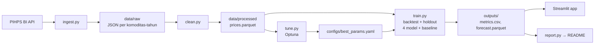

# 🌶️ PanganCast — Prediksi Harga Pangan Harian (PIHPS)

Forecasting harga harian **cabai, bawang, dan beras** di pasar tradisional Indonesia untuk horizon
**7, 14, dan 30 hari**, memakai data resmi **PIHPS Nasional Bank Indonesia**. Empat model —
**SARIMA, Prophet, XGBoost, LSTM** — dibandingkan secara adil melawan baseline naive dengan
protokol validasi yang identik, lalu disajikan di dashboard Streamlit yang bisa dipakai tanpa menulis kode.

**Demo:** _tambahkan link Streamlit Community Cloud setelah deploy_ · **Lisensi:** MIT

---

## Ringkasan 2 menit

- **Data**: 5 komoditas × 2 wilayah (Nasional, DI Yogyakarta) = **10 deret harian**, Januari 2018 – sekarang,
  diunduh langsung dari API tabel harga PIHPS (±22 ribu observasi hari kerja).
- **Validasi**: *rolling-origin* 12 fold × 30 hari + **holdout 90 hari** yang tidak disentuh saat tuning.
- **Metrik utama**: MASE, plus MAE, RMSE, MAPE, coverage interval 80/95%, dan akurasi arah.
- **Temuan utama**: harga harian PIHPS sangat "lengket" — **baseline naive (harga kemarin) sangat sulit
  dikalahkan**, terutama untuk beras dan bawang putih. Tabel di bawah melaporkan hasil apa adanya.

## Hasil

Seluruh angka di bagian ini ditulis otomatis oleh `make report` dari `outputs/metrics.csv`
(sumber tunggal yang juga dibaca dashboard).

<!-- RESULTS:START -->
_Data PIHPS 2018-01-01 s.d. 2026-09-24, dilatih 2026-09-24. Backtest 12 fold × 30 hari; holdout 90 hari terakhir._

**Model terbaik per deret (MASE backtest, horizon 7 hari)**

| Komoditas | Wilayah | Model terbaik | MAPE backtest | MAPE holdout | MASE vs naive | Target MAPE | Lolos? |
|---|---|---|---:|---:|---:|---:|:---:|
| Bawang Merah Ukuran Sedang | DI Yogyakarta | SARIMA | 3.01% | 4.25% | 1.164 | < 12% | ⚠️ |
| Bawang Merah Ukuran Sedang | Nasional | XGBoost | 1.42% | 2.15% | 0.836 | < 12% | ✅ |
| Bawang Putih Ukuran Sedang | DI Yogyakarta | SARIMA | 0.13% | 3.04% | 1.000 | < 12% | ⚠️ |
| Bawang Putih Ukuran Sedang | Nasional | SARIMA | 0.29% | 1.04% | 0.999 | < 12% | ✅ |
| Beras Kualitas Medium I | DI Yogyakarta | SARIMA | 0.01% | 0.34% | – | < 3% | – |
| Beras Kualitas Medium I | Nasional | XGBoost | 0.15% | 0.07% | 1.455 | < 3% | ⚠️ |
| Cabai Merah Keriting | DI Yogyakarta | SARIMA | 4.81% | 2.69% | 1.000 | < 12% | ⚠️ |
| Cabai Merah Keriting | Nasional | LSTM | 3.62% | 3.58% | 0.942 | < 12% | ✅ |
| Cabai Rawit Merah | DI Yogyakarta | LSTM | 6.31% | 4.03% | 1.189 | < 12% | ⚠️ |
| Cabai Rawit Merah | Nasional | LSTM | 3.74% | 2.85% | 0.884 | < 12% | ✅ |

✅ = MAPE di bawah target **dan** mengalahkan naive · ⚠️ = MAPE di bawah target tetapi tidak mengalahkan naive · ❌ = MAPE di atas target · – = harga konstan selama periode uji (naive sempurna, MASE relatif tidak terdefinisi).

**Semua deret (backtest) per model dan horizon** — MAPE rata-rata (%) / MASE relatif terhadap naive (rata-rata geometrik) / jumlah deret yang mengalahkan naive

| Model | H7 | H14 | H30 | Waktu train/fold |
|---|---:|---:|---:|---:|
| Naive | 2.31 / 1.000 / – | 4.06 / 1.000 / – | 7.10 / 1.000 / – | 0.00 s |
| SARIMA | 2.61 / 1.172 / 2/10 | 4.50 / 1.152 / 2/10 | 7.27 / 1.090 / 3/10 | 6.86 s |
| XGBoost | 2.53 / 1.240 / 2/10 | 4.18 / 1.167 / 3/10 | 6.84 / 1.097 / 3/10 | 7.42 s |
| LSTM | 2.47 / 1.274 / 3/10 | 4.14 / 1.220 / 2/10 | 6.65 / 1.102 / 3/10 | 63.02 s |
| Seasonal Naive | 4.40 / 2.016 / 0/10 | 5.52 / 1.478 / 0/10 | 7.96 / 1.166 / 0/10 | 0.00 s |
| Prophet | 13.11 / 7.515 / 0/10 | 13.80 / 5.226 / 0/10 | 14.47 / 2.969 / 0/10 | 24.01 s |

**Coverage interval prediksi (backtest H7, ideal 80% / 95%)**

| Model | Coverage 80% | Coverage 95% |
|---|---:|---:|
| Naive | 93.0% | 97.6% |
| SARIMA | 91.1% | 96.9% |
| XGBoost | 73.5% | 88.9% |
| LSTM | 84.4% | 95.8% |
| Seasonal Naive | 90.7% | 97.0% |
| Prophet | 57.6% | 77.9% |
<!-- RESULTS:END -->

### Temuan model

1. **Naive adalah baseline yang sangat kuat.** Harga PIHPS harian jarang bergerak dalam 7 hari (rata-rata
   MAPE naive H7 hanya 2,3%). Model terbaik mengalahkan naive pada **4 dari 10 deret** di backtest H7 —
   semuanya deret nasional (bawang merah, bawang putih, cabai merah keriting, cabai rawit merah). Target PRD
   "mengalahkan naive di semua komoditas" **tidak tercapai**, dan itu dilaporkan apa adanya.
2. **Target MAPE PRD tercapai di semua deret** (beras < 3%, cabai & bawang < 12%) — tetapi sebagian besar
   karena harga memang stabil dalam jangka pendek, bukan karena model istimewa. Karena itu MASE relatif
   terhadap naive dipakai sebagai metrik utama.
3. **LSTM unggul untuk cabai** (3 dari 4 deret cabai), paling jelas pada cabai rawit merah nasional
   (MASE 12% lebih baik dari naive di backtest, 26% di holdout). Harganya: training ±9× lebih lambat dari XGBoost.
4. **Keunggulan makin terasa di horizon panjang.** Pada H30, LSTM dan XGBoost memiliki MAPE rata-rata lebih
   rendah dari naive (6,7% dan 6,8% vs 7,1%).
5. **Di DI Yogyakarta, SARIMA memilih orde random walk** untuk beberapa komoditas sehingga prediksinya identik
   dengan naive — data provinsi lebih "berundak" (harga tetap berhari-hari lalu melompat).
6. **Prophet adalah model terlemah** (MAPE H7 13%) meski sudah di-tuning: tren piecewise-linear-nya
   mengekstrapolasi perubahan jangka pendek terlalu jauh. Interval Prophet juga paling tidak terkalibrasi.
7. **Tuning paling berdampak pada XGBoost** (MASE tuning 2,29 → 1,09): Optuna memilih model yang sangat
   teregularisasi (100 pohon, kedalaman 2) — sinyal prediktif harian lemah, jadi model "berhati-hati" menang.
8. **Lonjakan tetap sulit.** Pada tanggal ketika harga berubah > 15% dari origin, MAPE H7 semua model naik
   ke 18–24% (vs ±2% di periode normal). LSTM paling baik di periode lonjakan (17,8%).
9. **Uji Diebold-Mariano**: dari 10 deret, hanya keunggulan SARIMA atas naive pada bawang putih nasional yang
   signifikan (p = 0,03). Selisih antar model terbaik umumnya belum signifikan dengan 12 fold.
10. **Interval**: SARIMA dan LSTM paling terkalibrasi (coverage 95% ≈ 96–97%); XGBoost *under-cover*
    (80% nominal → 73% aktual) sehingga intervalnya sebaiknya dibaca lebih lebar.

### Cara membaca hasil

- **MASE vs naive** = MASE model ÷ MASE baseline naive pada fold & horizon yang sama. **< 1 berarti model
  mengalahkan naive.** (MASE mentah memakai penyebut naive satu-langkah in-sample, sehingga pada horizon
  multi-langkah nilainya wajar > 1 bahkan untuk model yang baik.)
- **Pemenang** per deret dipilih dari 4 model kandidat dengan MASE backtest terendah pada horizon 7 hari;
  baseline hanya menjadi patokan.
- **Coverage** mendekati 80%/95% berarti interval prediksi terkalibrasi.

## Temuan EDA

Dari [`notebooks/01_eda.ipynb`](notebooks/01_eda.ipynb):

| Komoditas | Volatilitas tahunan (nasional) | Karakter |
|---|---:|---|
| Cabai Rawit Merah | ±84% (DIY ±106%) | Sangat volatil; perubahan 7 hari p95 = +17% nasional, +35% DIY |
| Cabai Merah Keriting | ±77% | Sangat volatil, musiman lemah |
| Bawang Merah | ±58% | Musiman tahunan kuat (F_s ≈ 0,53), naik rata-rata +7% dari H-30 ke H-1 Lebaran |
| Bawang Putih | ±44% | Tren kuat, dipengaruhi impor |
| Beras Medium I | ±30% nasional, ±5% DIY | Sangat stabil; di DIY harga hampir tidak pernah berubah dalam 7 hari |

- Log harga beras dan bawang putih **tidak stasioner** pada level (ADF p = 0,99 / 0,10), stasioner setelah differencing.
- **Efek Lebaran** paling jelas pada bawang merah. Cabai justru rata-rata *turun* ±13% dari H-30 ke H-7 Lebaran
  pada periode 2018–2026 — efek hari raya tidak seragam antar komoditas.
- Pola mingguan lemah karena PIHPS hanya mencatat hari kerja.
- Nilai tunggal ekstrem pada hari libur (mis. 75.000 di tengah deret 45.000 pada 6 Juni 2019) adalah laporan
  segelintir pasar, bukan lonjakan nyata — dibuang oleh aturan pembersihan.

## Arsitektur



Training berjalan offline; dashboard hanya membaca `outputs/` sehingga ringan (tidak ada inferensi saat halaman dibuka).

### Model

| Model | Pendekatan | Detail | Interval prediksi |
|---|---|---|---|
| Naive / Seasonal naive | Baseline | harga besok = hari ini; lag 7 | σ random walk × √h |
| SARIMA | Statistik klasik | `auto_arima` (ADF, m=7) memilih orde sekali per deret, parameter di-fit ulang tiap fold | Analitik (state space) |
| Prophet | Dekomposisi aditif | Musiman mingguan + tahunan, hari raya H-14…H+7 (Idulfitri, Iduladha, Natal, Tahun Baru) | Kuantil *predictive samples* |
| XGBoost | Gradient boosting | *Direct*: model H7 (langkah 1–7), H14 (8–14), H30 (15–30); fitur lag 1–30, rolling mean/std 7/14/30, kalender, hari raya | *Split conformal* (residual 180 hari terakhir train) |
| LSTM (PyTorch) | Deep learning | Jendela input → vektor 30 langkah; Min-Max hanya dari train; dropout + early stopping | Kuantil residual validasi |

Semua model dilatih pada **log harga** dan dikembalikan ke Rupiah.

### Anti data leakage

- Scaler, imputasi, dan fitur rolling hanya memakai data ≤ origin (diuji di `tests/test_features.py`).
- Fitur lag dibuat dengan `shift` positif; fitur kalender tanggal target boleh dipakai karena diketahui sebelumnya.
- Tidak ada shuffle antar waktu; LSTM memakai celah sebesar horizon antara data train dan validasi.
- Tuning hanya memakai 4 fold backtest terakhir; holdout 90 hari dipakai sekali untuk laporan final.

## Menjalankan

Butuh Python 3.11+ (dikembangkan dengan 3.12). Di Windows tanpa `make`, jalankan perintah Python di kolom kanan.

| Langkah | `make` | Setara |
|---|---|---|
| Pasang dependensi | `make install` | `pip install -r requirements-dev.txt` |
| Unduh + bersihkan data | `make data` | `python -m src.ingest && python -m src.clean` |
| Tuning hyperparameter | `make tune` | `python -m src.tune` |
| Training + evaluasi | `make train` | `python -m src.train && python -m src.report` |
| Dashboard | `make app` | `streamlit run app/streamlit_app.py` |
| Test + coverage | `make test` | `pytest --cov=src` |
| Lint | `make lint` | `ruff check src app tests` |

Opsi berguna:

```bash
python -m src.train --models xgboost lstm --series nasional/cabai_rawit_merah   # run parsial
python -m src.train --evaluate-only      # hitung ulang metrik dari prediksi tersimpan
python -m src.ingest --refresh           # unduh ulang semua tahun
python -m src.ingest --from-excel file.xlsx --commodity cabai_rawit_merah   # jalur manual
```

**Reproducibility**: seed tetap (`configs/config.yaml`), versi library dikunci di `requirements-dev.txt`,
semua parameter di `configs/config.yaml` dan `configs/best_params.yaml`. Waktu komputasi `make train`
±30–40 menit pada CPU 12 thread.

### Deploy ke Streamlit Community Cloud

1. Push repo ke GitHub (termasuk `data/processed/` dan `outputs/`; `models/` tidak diperlukan).
2. Buat app baru → main file `app/streamlit_app.py`. `requirements.txt` hanya berisi dependensi dashboard.
3. Workflow `.github/workflows/retrain.yml` mengunduh data terbaru dan melatih ulang setiap Senin pagi,
   lalu meng-commit `outputs/` sehingga dashboard ikut ter-update.

## Struktur repo

```
├── app/                  # streamlit_app.py (entrypoint + sidebar) + pages/ (4 halaman)
├── configs/              # config.yaml, best_params.yaml (hasil tuning)
├── data/raw/             # snapshot JSON respons PIHPS (cache + mitigasi situs berubah)
├── data/processed/       # prices.parquet (skema: date, region, commodity, price, is_imputed)
├── models/               # model terlatih (.joblib, tidak di-commit)
├── notebooks/            # 01_eda.ipynb, 02_model_experiments.ipynb
├── outputs/              # metrics.csv, forecast.parquet, backtest_predictions.parquet, ...
├── src/
│   ├── ingest.py  clean.py  calendar_id.py  features.py
│   ├── models/           # naive.py arima.py prophet_model.py xgb.py lstm.py base.py
│   ├── backtest.py  evaluate.py  train.py  tune.py  report.py
├── tests/                # pytest (coverage src/ ≥ 60%)
└── .github/workflows/    # ci.yml (lint + test + smoke test dashboard), retrain.yml (mingguan)
```

## Keterbatasan

- Belum memakai variabel eksogen (curah hujan, kurs, kebijakan impor) — lonjakan akibat *shock* sulit diantisipasi.
- Nilai akhir pekan/libur adalah hasil imputasi karena PIHPS hanya mencatat hari kerja.
- Rata-rata nasional/provinsi menyembunyikan variasi antarpasar.
- Target MAPE di PRD adalah asumsi awal; hasil di atas menunjukkan target mana yang realistis.

## Pengembangan lanjutan (v2.0)

Variabel eksogen (BMKG, inflasi, kurs, BBM) · N-BEATS / TFT / Chronos · model global semua provinsi ·
update harian + notifikasi Telegram/WhatsApp · API FastAPI.

## Sumber data & etika

Data: [PIHPS Nasional — Bank Indonesia](https://www.bi.go.id/hargapangan), pasar tradisional. Hak atas data
tetap pada Bank Indonesia. Pengunduh memakai jeda 2 detik antar request, satu request per komoditas-tahun,
dan cache lokal agar tidak membebani server.

_Prediksi bersifat indikatif, bukan saran transaksi._
